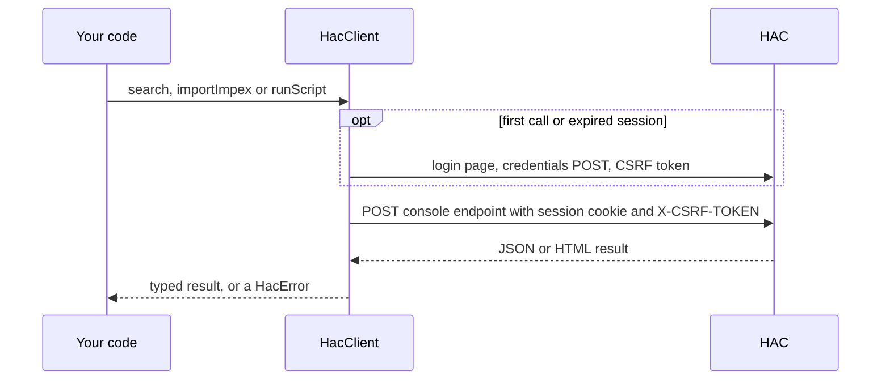

# hybris-hac-api

A small Node.js client for the SAP Commerce (Hybris) Administration Console (HAC). It logs in to HAC the way a browser does and drives three console endpoints from code:

- ImpEx import (`/console/impex/import`)
- FlexibleSearch (`/console/flexsearch/execute`)
- Script execution, Groovy by default (`/console/scripting/execute`)

Typical uses are test-data setup and teardown in end-to-end suites, CI smoke checks and one-off maintenance scripts.

This is a fork of [AlexGrisin/hybris-hac-api](https://github.com/AlexGrisin/hybris-hac-api). It keeps the original four functions and adds a typed client with session reuse, timeouts, a single safe retry, CSRF and session recovery, opt-in TLS verification and typed errors. See [Fork changes vs upstream](#fork-changes-vs-upstream).

More documentation:

- [docs/ARCHITECTURE.md](docs/ARCHITECTURE.md): design, HAC protocol, session lifecycle, error model, retry policy, extension guide.
- [docs/USAGE-GUIDE.md](docs/USAGE-GUIDE.md): practical recipes such as a safe "remove items by explicit code" cleanup, dry runs and CI usage.
- [CHANGELOG.md](CHANGELOG.md)

## Contents

- [Install](#install)
- [Quick start](#quick-start)
- [Configuration](#configuration)
- [API reference](#api-reference)
- [Error handling](#error-handling)
- [Retry, session and CSRF recovery](#retry-session-and-csrf-recovery)
- [TLS](#tls)
- [Proxy](#proxy)
- [Logging](#logging)
- [Troubleshooting](#troubleshooting)
- [Fork changes vs upstream](#fork-changes-vs-upstream)
- [Credits and licence](#credits-and-licence)

## Install

Requires Node.js 18 or later. Runtime dependencies: `dotenv` and `he`.

The npm name `hybris-hac-api` belongs to the upstream package, and this fork is not published there. Install it from the fork's Git repository (pin a tag or commit in real projects):

```shell
npm install github:syamphaneendra/hybris-hac-api
```

Installing `hybris-hac-api` from the npm registry gives you upstream 1.1.9, not this fork.

## Quick start

Set the connection in the environment, or in a `.env` file in the working directory:

```shell
HAC_HOST=https://hac.example.com
HAC_USER=admin
HAC_PASSWORD=<your HAC password>
```

Then use the client:

```javascript
const { createHacClient } = require('hybris-hac-api');

async function main() {
  const hac = createHacClient(); // reads HAC_* variables; throws HacConfigError if invalid
  try {
    const { rows } = await hac.search("SELECT {code} FROM {Product} WHERE {code} = 'PRODUCT-0001'");
    console.log(rows); // e.g. [ { code: 'PRODUCT-0001' } ]

    const result = await hac.importImpex(
      'INSERT_UPDATE Product; code[unique=true]; name[lang=en]\n; PRODUCT-0001 ; Sample product',
    );
    console.log(result.message); // 'Import finished successfully'

    const { output } = await hac.runScript('println "hello"', { commit: false });
    console.log(output); // 'hello\n'
  } finally {
    hac.close();
  }
}

main().catch((err) => {
  console.error(err.code, err.message);
  process.exitCode = 1;
});
```

The client logs in on the first call and reuses the session for later calls. Every call resolves only after HAC has answered, and rejects with a `HacError` subclass when anything fails.



Caption: what one call does; the details are in [ARCHITECTURE.md](docs/ARCHITECTURE.md#hac-communication-protocol).

The original function-style API still works:

```javascript
const hac = require('hybris-hac-api');

await hac.impexImport('INSERT_UPDATE Product; code[unique=true]; name[lang=en]\n; PRODUCT-0001 ; Sample product');
const row = await hac.flexibleSearch("SELECT {code}, {name} FROM {Product} WHERE {code} = 'PRODUCT-0001'");
console.log(row.code); // first row only
const json = await hac.executeScript('println "hello"');
console.log(json.outputText);
```

Both CommonJS (`require`) and ESM (`import hac from 'hybris-hac-api'` or named imports) work.

## Configuration

Each setting is resolved in this order: explicit `createHacClient` option (when not `undefined`), then the environment variable (when set and not empty), then the default. Falsy option values such as `retries: 0` or `contextPath: ''` are honoured.

Requiring the package loads a `.env` file from `process.cwd()` once, through `dotenv`. Variables already set in the environment win over `.env`.

| Environment variable | Option | Default | Description |
|---|---|---|---|
| `HAC_HOST` | `host` | required | HAC origin, e.g. `https://hac.example.com` or `https://hac.example.com:9002`. Do not add the `/hac` suffix (that is `HAC_CONTEXT_PATH`). Must be `http:` or `https:`, without `user:password@`, query or hash. A trailing `/` is removed. |
| `HAC_USER` | `user` | `admin` | HAC user. Preferred over `USER_NAME`. |
| `USER_NAME` | | `admin` | Legacy fallback for `HAC_USER`. |
| `HAC_PASSWORD` | `password` | `nimda` | HAC password. Preferred over `PASSWORD`. Never logged and redacted from error messages. |
| `PASSWORD` | | `nimda` | Legacy fallback for `HAC_PASSWORD`. |
| `HYBRIS_VERSION` | `hybrisVersion` | `5.7` | Versions below 5.7 use the per-language endpoint `/console/<scriptType>/execute`. Compared numerically by major.minor, so `5.10` is newer than `5.7`. Non-numeric values count as modern. |
| `HAC_CONTEXT_PATH` | `contextPath` | `/hac` | HAC web context path. Use `/` (env) or `''`/`'/'` (option) when HAC is mounted at the root. |
| `HAC_TIMEOUT_MS` | `timeoutMs` | `120000` | Overall timeout per request, 1..86400000 ms. Login requests use at most 60000 ms. |
| `HAC_CONNECT_TIMEOUT_MS` | `connectTimeoutMs` | `10000` | TCP + TLS connect timeout for a new socket, 1..600000 ms. |
| `HAC_RETRIES` | `retries` | `1` | `1` allows one transient retry per call and one login restart. `0` disables both. |
| `HAC_RETRY_DELAY_MS` | `retryDelayMs` | `500` | Base backoff before a retry, 0..60000 ms. A random 0..50 % is added. |
| `HAC_TLS_REJECT_UNAUTHORIZED` | `tls.rejectUnauthorized` | `false`, or `true` when a CA is supplied | Verify the HAC TLS certificate. Env accepts `true/false/1/0/yes/no`. |
| `HAC_CA_CERT` | `tls.ca` | unset | Env: path to a PEM CA bundle. Option: PEM string, `Buffer` or an array of them. Supplying a CA turns verification on. |
| `HAC_DEBUG` | | `false` | Print structured debug events with `console.debug` (ignored when a `logger` option is given). |
| `HTTP_PROXY` / `http_proxy` | `proxy` | unset | Proxy for `http:` HAC hosts. |
| `HTTPS_PROXY` / `https_proxy` | `proxy` | unset | Proxy (CONNECT tunnel) for `https:` HAC hosts. |
| `NO_PROXY` / `no_proxy` | | unset | Comma-separated hosts that bypass the env proxy. `*` matches all; a leading `.` matches a suffix. |

Two options have no environment variable:

- `logger`: an object with `debug`/`info`/`warn` methods (for example `console` or a pino logger).
- `env`: the object to read variables from instead of `process.env`. Handy in tests.

Invalid values throw `HacConfigError` synchronously from `createHacClient`. The error names the option or variable and the rule, never the value.

> The `admin`/`nimda` defaults are the stock SAP Commerce credentials and are kept only for compatibility with upstream. Always set `HAC_USER` and `HAC_PASSWORD` explicitly, and keep the password in a secret store or CI secret, never in source control.

The legacy `configure()` function overrides `HAC_HOST`, `HAC_USER`, `HAC_PASSWORD` and `HYBRIS_VERSION` for the legacy functions only. All other settings are read from the environment.

## API reference

### Client API

#### `createHacClient(options?)` / `new HacClient(options?)`

Creates a client with its own cookie jar, CSRF token and keep-alive connection pool. Options are listed in [Configuration](#configuration). No network I/O happens here.

```javascript
const { createHacClient } = require('hybris-hac-api');

const hac = createHacClient({
  host: process.env.HAC_HOST,          // e.g. https://hac.example.com
  user: process.env.HAC_USER,
  password: process.env.HAC_PASSWORD,
  timeoutMs: 300000,
  tls: { ca: require('node:fs').readFileSync('ca.pem') },
});
```

`JSON.stringify(hac)` and `util.inspect(hac)` show only `{ host, contextPath, state }`, never the password.

#### `client.login(): Promise<void>`

Logs in now. Optional, because every operation logs in on demand. Does nothing when the client is already logged in, and joins a login that is already running.

#### `client.importImpex(script, options?): Promise<ImpexResult>`

Posts an ImpEx script to `{ctx}/console/impex/import` and resolves after HAC reports success.

| Option | Default | Notes |
|---|---|---|
| `validationMode` | `'IMPORT_STRICT'` | or `'IMPORT_RELAXED'` |
| `maxThreads` | `16` | 1..64 |
| `encoding` | `'UTF-8'` | |
| `legacyMode` | `false` | |
| `enableCodeExecution` | `false` | enables bean shell / Groovy in the ImpEx |
| `timeoutMs` | client value | per-call override |
| `retryOnTransientError` | see [Retry](#retry-session-and-csrf-recovery) | |

Resolves to `{ success: true, level, message }`. `level` is HAC's result level (`'notice'`, `'info'`, …) or `null`.

```javascript
const { level, message } = await hac.importImpex(
  'UPDATE Product; code[unique=true]; name[lang=en]\n; PRODUCT-0001 ; Renamed product',
  { validationMode: 'IMPORT_RELAXED' },
);
```

Rejects with `HacImpexError` (HAC reported a failure) or `HacResponseError` (the result page could not be recognised). Unknown pages are treated as failures, never as success.

#### `client.search(query, options?): Promise<SearchResult>`

Runs a FlexibleSearch query through `{ctx}/console/flexsearch/execute` and returns all rows, up to `maxCount`.

| Option | Default | Notes |
|---|---|---|
| `maxCount` | `200` | 1..100000 |
| `user` | `'admin'` | HAC "execute as" user |
| `locale` | `'en'` | |
| `timeoutMs` | client value | |
| `retryOnTransientError` | full single retry | search is read-only |

Resolves to:

```javascript
{
  headers: ['p_code', 'p_name'],   // as HAC returns them
  columns: ['code', 'name'],       // leading 'p_' removed unless that would collide
  rows: [{ code: 'PRODUCT-0001', name: 'Sample product' }],
  rowCount: 1,
}
```

Values are HTML-decoded and `null` stays `null`. An empty result is `rows: []`, not an error. A query that HAC rejects becomes `HacFlexibleSearchError` with `hacMessage`.

#### `client.runScript(script, options?): Promise<ScriptResult>`

Executes a script through `{ctx}/console/scripting/execute` (or `{ctx}/console/<scriptType>/execute` when `hybrisVersion` is below 5.7).

| Option | Default | Notes |
|---|---|---|
| `scriptType` | `'groovy'` | letters only |
| `commit` | `true` | boolean. `false` asks HAC to roll back the script's transaction |
| `timeoutMs` | client value | |
| `retryOnTransientError` | see [Retry](#retry-session-and-csrf-recovery) | |

Resolves to `{ output, result, raw }`: HAC's `outputText`, `executionResult` and the full JSON. A non-empty `stacktraceText` becomes `HacScriptError` with `stacktrace` and `output`.

```javascript
const { output, result } = await hac.runScript('println "items: 3"; return 3', { commit: false });
```

#### `client.close(): void`

Closes the client immediately: clears cookies and the token and destroys the sockets. Calls still running fail, later calls reject with `HacClientClosedError`. Safe to call more than once. There is no HTTP logout; HAC expires the session on its side.

### Legacy API

These functions use one shared default client, created on first use from the environment and the values passed to `configure()`. If those values change, the next call gets a fresh client; calls already running finish on the old one.

| Function | Resolves to | Notes |
|---|---|---|
| `configure(host?, user?, password?, hybrisVersion?)` | the module exports object | Each argument is applied only when truthy. |
| `impexImport(script)` | `undefined` | Waits for HAC and rejects on failure (upstream did not, see below). |
| `flexibleSearch(query)` | first row as `{ [column]: string }` | Keys have the first `p_` removed, `null` becomes `''`, values HTML-decoded. Zero rows reject with `HacNoResultsError`. Uses `maxCount` 200. |
| `executeScript(script, commit = 'true', scriptType = 'groovy')` | raw HAC JSON | `commit` is sent as `String(commit)`. |

```javascript
const hac = require('hybris-hac-api');

hac.configure('https://hac.example.com', process.env.HAC_USER, process.env.HAC_PASSWORD, '2211');

await hac.impexImport('REMOVE Product; code[unique=true]\n; PRODUCT-0001');

try {
  const row = await hac.flexibleSearch("SELECT {code} FROM {Product} WHERE {code} = 'PRODUCT-0001'");
  console.log('still there', row.code);
} catch (err) {
  if (err.code !== 'HAC_NO_RESULTS') throw err;
}

const json = await hac.executeScript('println "hello"', false, 'groovy');
console.log(json.outputText);
```

The deep-require paths from upstream still load and use the same default client: `hybris-hac-api/src/config` (`{ config, updateConfig }`), `src/HACApiConnect` (`{ login }`), `src/ImpexImportExecute` (`{ impexImportExecute }`), `src/FlexibleSearchExecute` (`{ flexibleSearchExecute }`) and `src/ScriptExecute` (`{ scriptExecute }`). New code should use the exports from the package root.

### Exports

`configure`, `impexImport`, `flexibleSearch`, `executeScript`, `createHacClient`, `HacClient`, and the error classes `HacError`, `HacConfigError`, `HacInputError`, `HacTransportError`, `HacTimeoutError`, `HacHttpError`, `HacAuthError`, `HacSessionExpiredError`, `HacCsrfError`, `HacResponseError`, `HacReportedError`, `HacImpexError`, `HacScriptError`, `HacFlexibleSearchError`, `HacNoResultsError`, `HacClientClosedError`.

TypeScript declarations ship in `index.d.ts`.

## Error handling

Every rejection is a `HacError` (which extends `Error`). Branch on `err.code` or `instanceof`.

| Class | `code` | When | Extra fields |
|---|---|---|---|
| `HacConfigError` | `HAC_CONFIG` | Missing or invalid configuration | `variable` |
| `HacInputError` | `HAC_INVALID_INPUT` | Empty script or query, bad option; nothing was sent | `argument` |
| `HacTransportError` | `HAC_TRANSPORT` | Socket, DNS or TLS failure | `networkCode` |
| `HacTimeoutError` | `HAC_TIMEOUT` | Connect or overall timeout (subclass of `HacTransportError`) | `phase` (`connect`/`response`), `timeoutMs` |
| `HacHttpError` | `HAC_HTTP_STATUS` | Unexpected HTTP status, unexpected or cross-origin redirect, failed proxy CONNECT | `bodyExcerpt`, `redirectOrigin`, `phase` |
| `HacAuthError` | `HAC_AUTH` | HAC rejected the login | `reason` |
| `HacSessionExpiredError` | `HAC_SESSION_EXPIRED` | Still sent to the login page after one re-login | |
| `HacCsrfError` | `HAC_CSRF` | No CSRF token found, or 403 again after one token refresh | |
| `HacResponseError` | `HAC_UNEXPECTED_RESPONSE` | Unparseable or unrecognised response, body over 50 MiB, unsupported `Content-Encoding` | `bodyExcerpt` |
| `HacReportedError` | (base class) | Parent of the three HAC-reported failures below | |
| `HacImpexError` | `HAC_IMPEX_FAILED` | HAC reported that the import failed | `level`, `result` |
| `HacScriptError` | `HAC_SCRIPT_FAILED` | HAC returned a stack trace | `stacktrace`, `output` |
| `HacFlexibleSearchError` | `HAC_FLEXSEARCH_FAILED` | HAC returned a query exception | `hacMessage` |
| `HacNoResultsError` | `HAC_NO_RESULTS` | Legacy `flexibleSearch` only: zero rows | `query` |
| `HacClientClosedError` | `HAC_CLIENT_CLOSED` | Call on a closed client | |

All errors may also carry `operation` (`login`, `csrf`, `impexImport`, `search`, `runScript`), `method`, `path` (no host or query), `status` and `attempts` (number of times the operation request was sent). `cause` holds the underlying Node error when there is one.

Messages and excerpts never contain the password, cookies, CSRF tokens or the request body. `err.toJSON()` (used by `JSON.stringify`) leaves out `cause` and the stack. One caveat: `HacImpexError.result` is HAC's own report, which can quote values from the failing ImpEx line.

```javascript
const { HacError, HacImpexError, HacAuthError } = require('hybris-hac-api');

try {
  await hac.importImpex(impex);
} catch (err) {
  if (err instanceof HacImpexError) {
    console.error(`ImpEx failed (${err.level}): ${err.result}`);
  } else if (err instanceof HacAuthError) {
    console.error(`Login rejected: ${err.reason}`);
  } else if (err instanceof HacError) {
    console.error(err.code, err.message, err.toJSON());
  }
  throw err;
}
```

## Retry, session and CSRF recovery

Each operation call sends its request at most 3 times. Within that cap the client can spend:

- one re-login and replay when HAC answers with a redirect to the login page, a login page body or 401 (session expired);
- one CSRF token refresh and replay on 403;
- one transient retry, after a backoff of `retryDelayMs` plus up to 50 % jitter (a numeric `Retry-After` of 5 s or less on 503 is used instead).

Which transient failures are retried depends on the operation:

| Failure | `search` (read-only) | `importImpex`, `runScript` |
|---|---|---|
| Connect-phase: `ECONNREFUSED`, `EAI_AGAIN`, connect timeout, … (nothing was sent) | retried | retried |
| Mid-flight: `ECONNRESET`, `EPIPE`, socket hang up, `ETIMEDOUT` after connect | retried | only with `retryOnTransientError: true` |
| HTTP 502, 503, 504 | retried | only with `retryOnTransientError: true` |
| Response timeout, other HTTP statuses, TLS errors, `ENOTFOUND`, HAC-reported failures | never | never |

`retryOnTransientError: false` on a call disables transient retries for that call. `retries: 0` (or `HAC_RETRIES=0`) disables them for the whole client and also disables the login restart; it wins over a per-call `true`. Re-login and CSRF replays are not transient retries and stay on.

The login sequence (login page, credentials POST, redirects, CSRF fetch) is never retried step by step. On a transient failure it is restarted once from the beginning with a clean cookie jar, when `retries` is 1.

Concurrent calls on one client share a single login and a single CSRF refresh.

## TLS

For compatibility with upstream, TLS certificate verification is **off by default** for `https:` hosts. That exposes the HAC password and data to anyone who can intercept the connection. Turn it on:

```shell
# verify against Node's default trust store (NODE_EXTRA_CA_CERTS also works)
HAC_TLS_REJECT_UNAUTHORIZED=true

# or verify against a private CA (this alone turns verification on)
HAC_CA_CERT=/path/to/ca.pem
```

```javascript
createHacClient({ tls: { rejectUnauthorized: true } });
createHacClient({ tls: { ca: fs.readFileSync('/path/to/ca.pem') } });
```

If a CA is supplied together with an explicit `rejectUnauthorized: false` (option or env), the CA is ignored and a `tls.ca_ignored` warning goes to the logger. Certificate errors such as `DEPTH_ZERO_SELF_SIGNED_CERT` become `HacTransportError` with that `networkCode` and are not retried.

## Proxy

Proxies are taken from `http_proxy`/`HTTP_PROXY` (for `http:` HAC hosts) or `https_proxy`/`HTTPS_PROXY` (for `https:` hosts, through a CONNECT tunnel), lower-case names first, unless `no_proxy`/`NO_PROXY` matches the HAC host. The `proxy` option sets an explicit proxy URL (used even when `NO_PROXY` matches) and `proxy: false` ignores the env vars.

Only `http://[user:pass@]host:port` proxy URLs are supported; `https:` proxy URLs are rejected with `HacConfigError`. Proxy credentials are redacted from errors and logs. A refused CONNECT becomes `HacHttpError` with `phase: 'connect'`.

## Logging

The client is silent by default. Pass a `logger`, or set `HAC_DEBUG=true` to print events with `console.debug`:

```javascript
createHacClient({ logger: console });
// logs e.g. '[hybris-hac-api] http.response' { method: 'POST', path: '/hac/console/flexsearch/execute', status: 200, durationMs: 42 }
```

Events include `http.response`, `login.success`, `login.restart`, `session.expired`, `csrf.forbidden`, `csrf.refreshed`, `request.retry`, `proxy.selected`, `tls.insecure` and `tls.ca_ignored`. Only allow-listed fields are logged (`operation`, `method`, `path`, `status`, `durationMs`, `attempt`, `reason`, `proxy`, `variable`). Bodies, scripts, queries, headers, cookies, tokens and credentials are never logged. A logger that throws cannot break a call.

## Troubleshooting

| Symptom | Likely cause and fix |
|---|---|
| `HAC_HOST is not configured…` | `HAC_HOST` is missing. Set it in the environment or `.env`, or pass `host`. |
| `HacConfigError` naming `HAC_HOST` | The value has a query, hash or `user:password@` credentials, or no `http(s):` scheme. Use the origin, e.g. `https://hac.example.com:9002`. |
| 404 on `/hac/login.jsp` | HAC runs under another context path. Set `HAC_CONTEXT_PATH` (e.g. `/` for root). Do not put `/hac` into `HAC_HOST`. |
| `HacAuthError` | Wrong user or password, or a locked account. `err.reason` holds HAC's login error text. Check that `HAC_USER`/`HAC_PASSWORD` are set; otherwise the `admin`/`nimda` defaults are used. |
| `HacHttpError` "redirected to a different origin" | HAC redirects, e.g. from `http://…:9001` to `https://…:9002`. Set `HAC_HOST` to the origin named in the message. |
| `HacCsrfError` | No CSRF token was found on the HAC page, or HAC (or a proxy/WAF) kept answering 403. Check the user's HAC permissions and anything in front of HAC. |
| `HacSessionExpiredError` | HAC kept sending the client back to the login page after a re-login. Often a load balancer without session affinity, or a very short session timeout. |
| `HacTimeoutError` with `phase: 'response'` | The import or script took longer than `timeoutMs`. Raise `HAC_TIMEOUT_MS` or the per-call `timeoutMs`. HAC may still finish the work. |
| `HacTimeoutError` with `phase: 'connect'` or `ECONNREFUSED` | Host or port unreachable, VPN or proxy missing. |
| `HacTransportError` with a certificate `networkCode` | TLS verification is on and the certificate is not trusted. Supply `HAC_CA_CERT`. |
| `HacResponseError` "unrecognised ImpEx response" | The result page did not match known HAC markup (for example after a HAC upgrade, or a proxy error page). See `err.bodyExcerpt`, and [Limitations](docs/ARCHITECTURE.md#limitations). |
| `HacNoResultsError` | Legacy `flexibleSearch` found no rows. Use `client.search`, which returns `rows: []`. |
| Need more detail | Run with `HAC_DEBUG=true` and check `err.toJSON()` (safe to log). |

## Fork changes vs upstream

Compared with upstream `hybris-hac-api@1.1.9`. The full list, including smaller behaviour changes, is in the [CHANGELOG](CHANGELOG.md).

Fixes:

- `impexImport` now awaits HAC and rejects on transport errors, HTTP errors, expired sessions and HAC-reported ImpEx failures. Upstream resolved immediately, before the import ran, and a failure became an unhandled rejection. **Pipelines that used to pass while imports silently failed will now fail.**
- No implicit globals (`configure`, `login`, `config`, `instance`, …); `'use strict'` everywhere.
- `HAC_USER`/`HAC_PASSWORD` are read as the README always said (`USER_NAME`/`PASSWORD` still work as fallbacks).
- The `hybrisVersion` passed to `configure()` is honoured, and `5.10`-style versions compare correctly.
- FlexibleSearch query errors are reported as `HacFlexibleSearchError` instead of "returned 0 results".
- Login failures, expired sessions and unexpected pages give clear errors instead of `TypeError`s.
- Credentials and session cookies no longer leak into error objects; the ImpEx script is no longer put into error messages; the success HTML is no longer `console.log`ged.
- All cookies are kept (including load-balancer affinity cookies) and CSRF extraction is tolerant of markup variations.

Additions:

- `createHacClient` / `HacClient` with session reuse, `search` returning all rows, structured `ImpexResult` and `ScriptResult`, and per-call options.
- Typed error hierarchy with stable `code` values.
- Configurable timeouts, context path, retries, TLS verification (CA or trust store), proxy and logger.
- TypeScript declarations, a test suite against a local HAC stub, ESLint and type checking.
- axios, axios-cookiejar-support, tough-cookie and jsdom replaced by Node's `http`/`https`; runtime dependencies are only `dotenv` and `he`.

Behaviour changes to check when upgrading: rejections are `HacError`s instead of axios errors (`err.status`, not `err.response.status`); Node 18+ is required; cross-origin redirects are no longer followed; empty scripts or queries reject with `HacInputError`; `config.HAC_PASSWORD` is non-enumerable; `HYBRIS_VERSION` is read once at require time for the legacy API. See the CHANGELOG for the full list.

## Development

```shell
npm ci
npm run check   # lint + type check + tests
npm test        # tests only, against a local HAC stub (no network)
npm run test:coverage
```

`scripts/gen-test-certs.sh` regenerates the test TLS certificates in `test/fixtures/tls/`.

## Credits and licence

Original library by Alexandr Grisin: [AlexGrisin/hybris-hac-api](https://github.com/AlexGrisin/hybris-hac-api), published on npm as `hybris-hac-api@1.1.9`. This fork is maintained at [syamphaneendra/hybris-hac-api](https://github.com/syamphaneendra/hybris-hac-api).

ISC licence. See [LICENSE](LICENSE) (Copyright (c) 2022 Alexandr Grisin, Copyright (c) 2026 Syamphaneendra Kalluri).

SAP, SAP Commerce and Hybris are trademarks of SAP SE. This project is not affiliated with or endorsed by SAP.
