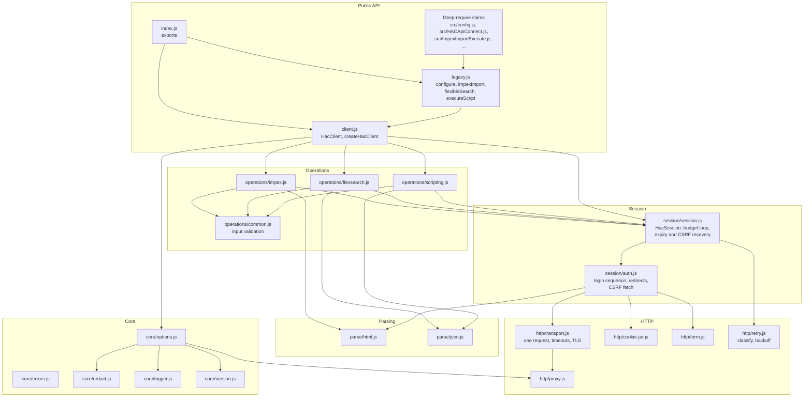
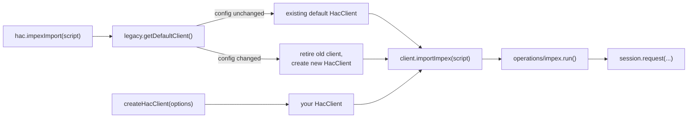
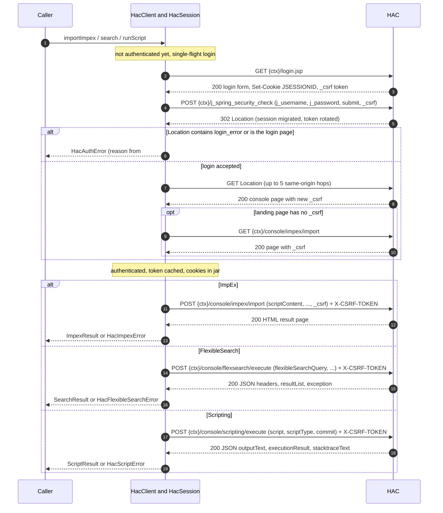
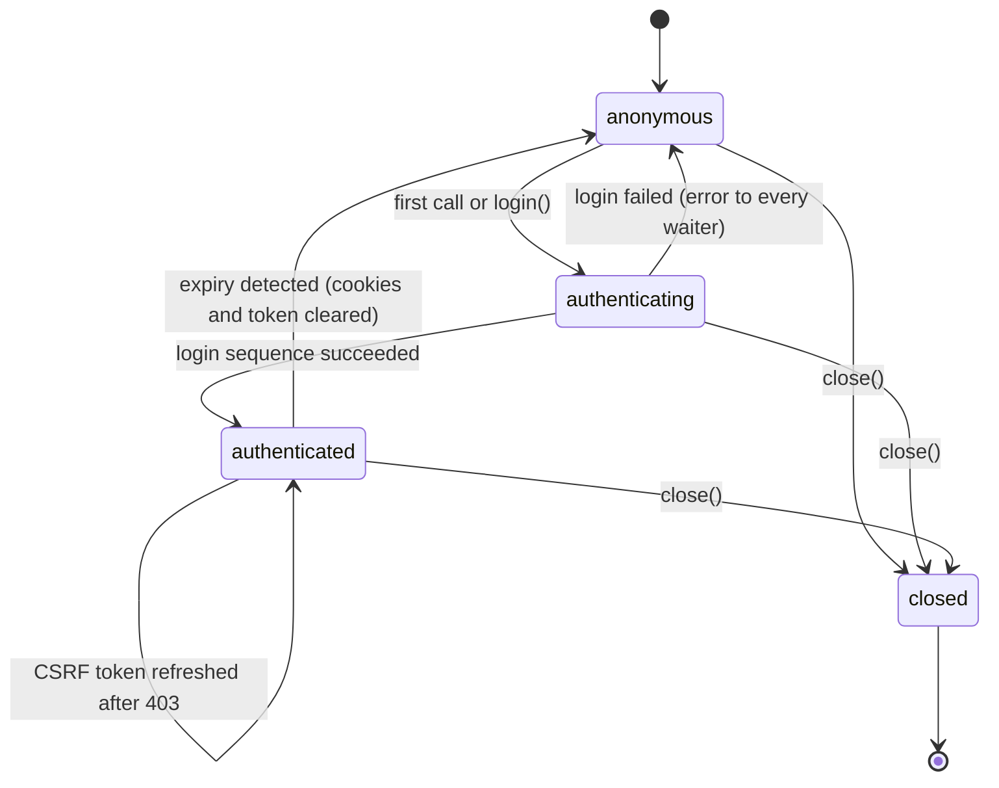
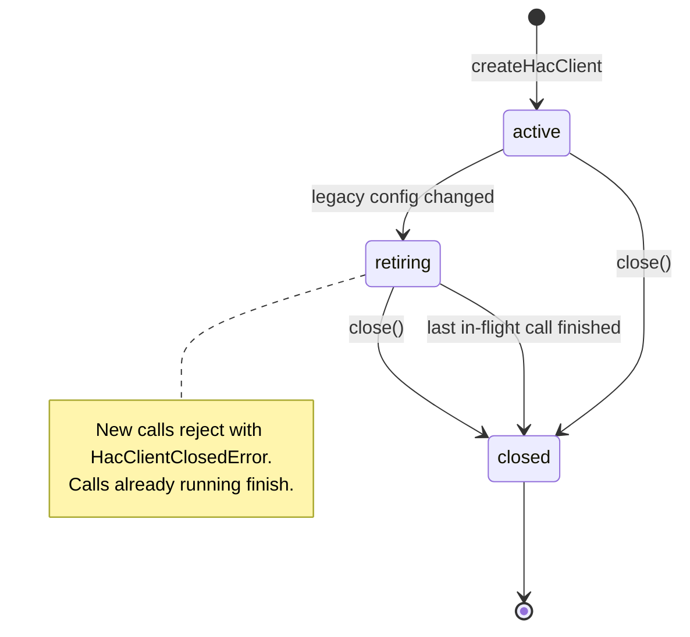
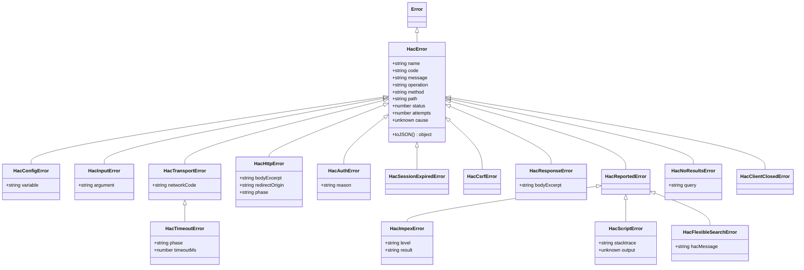
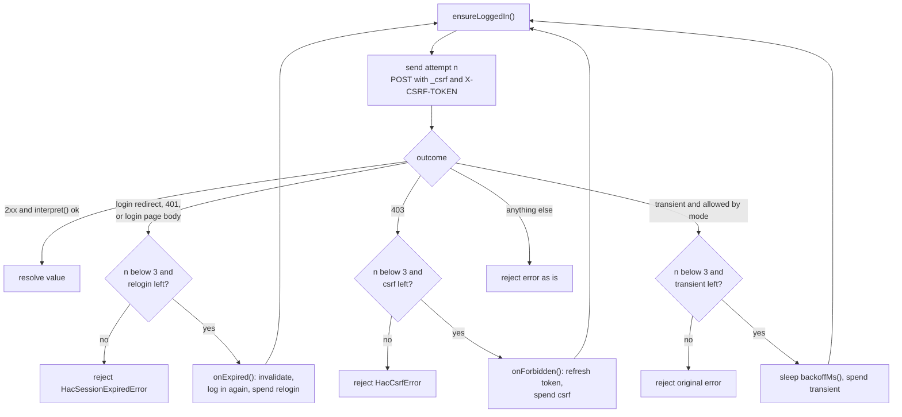
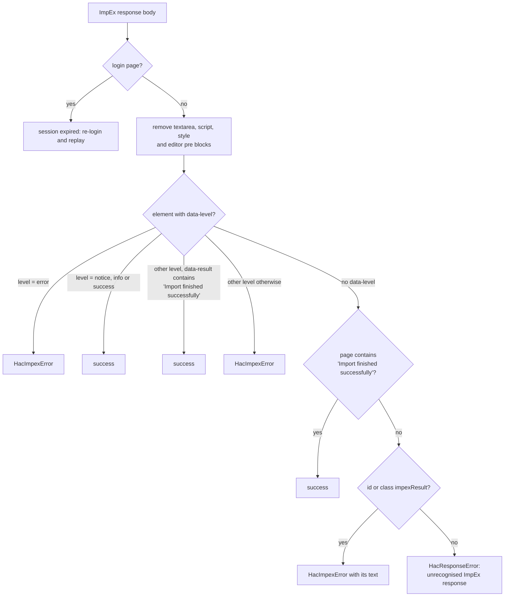
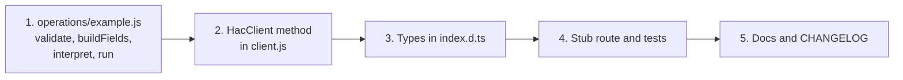

# Architecture

How `hybris-hac-api` is built, how it talks to HAC, and how to extend it. For usage see the [README](../README.md) and the [usage guide](USAGE-GUIDE.md).

## Contents

- [Basics: what HAC is and why a client is needed](#basics-what-hac-is-and-why-a-client-is-needed)
- [Design goals](#design-goals)
- [Components](#components)
- [Module responsibilities](#module-responsibilities)
- [HAC communication protocol](#hac-communication-protocol)
- [Session lifecycle](#session-lifecycle)
- [Error model](#error-model)
- [Retry policy](#retry-policy)
- [Request and response parsing](#request-and-response-parsing)
- [Security considerations](#security-considerations)
- [Limitations](#limitations)
- [Extension guide: adding a console endpoint](#extension-guide-adding-a-console-endpoint)

## Basics: what HAC is and why a client is needed

The SAP Commerce (Hybris) Administration Console (HAC) is a web application, by default mounted at `/hac`, that administrators use from a browser. Its console pages run ImpEx imports, FlexibleSearch queries and Groovy scripts against a running platform.

HAC has no public REST API. Its console pages call a few internal endpoints with HTML forms and AJAX, behind Spring Security form login with CSRF protection. To use HAC from code, a client has to behave like the browser:

1. open the login page to get a session cookie and a CSRF token;
2. post the credentials to the Spring Security login URL;
3. pick up the CSRF token that Spring issues after login;
4. post forms to the console endpoints with the session cookie and the token;
5. read the answer: JSON for FlexibleSearch and scripting, an HTML page for ImpEx.

This library packages those steps, plus the recovery that real environments need (expired sessions, rotated tokens, flaky networks), behind a small API.

## Design goals

| Goal | How it shows up in the code |
|---|---|
| A call resolves only when HAC has answered | Every request is awaited; there are no detached promises. `impexImport` resolves only after HAC reports success. |
| Fail closed | A response that cannot be classified is an error (`HacResponseError`), never a success. |
| Backward compatibility | The four upstream functions, their arguments, defaults and resolved shapes, the deep-require paths and the env names are kept. |
| One session per client | A client logs in once and reuses its cookies and CSRF token. Concurrent calls share one login. |
| Safe retries | At most one transient retry per call. Non-idempotent operations (ImpEx, scripts) are only retried when the request was never sent, unless the caller opts in. |
| No secret leaks | Errors carry scalar fields only; messages and excerpts are redacted; logging is allow-listed. |
| Small dependency footprint | Node's `http`/`https`/`net`/`tls` only, plus `dotenv` and `he`. |
| Testable without a real HAC | All HTTP goes through one transport; tests run against a local HAC stub on `127.0.0.1`. |
| HAC markup changes are contained | All HTML/JSON interpretation lives in `src/parse/` and the operations' `interpret()` functions. |

## Components

The library is layered: public API on top, a session layer that owns login and recovery, operations that know each endpoint, and the HTTP and parsing layers at the bottom.

Block diagram of the layers and their dependencies (arrows point from caller to callee):



Caption: module dependencies by layer. Every layer also throws errors from `core/errors.js`; those edges are left out to keep the diagram readable.

A legacy call and a client call end up in the same place. The legacy layer only decides which client to use:



Caption: legacy functions route through a shared default client; explicit clients call the same operation code.

## Module responsibilities

| Module | Responsibility |
|---|---|
| `index.js` | Single `module.exports` object: the legacy functions, `createHacClient`, `HacClient` and all error classes. Written as one object literal so ESM named imports work. |
| `src/legacy.js` | The default client for the legacy API. Snapshots `HAC_HOST`, `HAC_USER`, `HAC_PASSWORD`, `HYBRIS_VERSION` from the legacy `config` object; when any of them changes, the old client is retired and a new one created. Maps legacy result shapes. |
| `src/config.js` | Legacy `config` object and `updateConfig()`. Loads `.env` once with `dotenv`. `HAC_PASSWORD` is non-enumerable. |
| `src/HACApiConnect.js`, `src/ImpexImportExecute.js`, `src/FlexibleSearchExecute.js`, `src/ScriptExecute.js` | Deep-require shims with the upstream export names; they delegate to `legacy.js`. |
| `src/client.js` | `HacClient`: resolves options (no I/O), wires transport, cookie jar and session, counts in-flight calls, handles `close()` and retirement (`active`, `retiring`, `closed`). Holds the password in a private field. |
| `src/core/options.js` | Option/env/default resolution and validation (`HacConfigError`), TLS and proxy resolution, the `ENV_VARS` table. |
| `src/core/errors.js` | `HacError` hierarchy, stable codes, safe `toJSON()`, `withAttempts()`. |
| `src/core/redact.js` | Masks the password (three encodings), `j_password=`, `JSESSIONID=`, `_csrf` values, `X-CSRF-TOKEN`, `Proxy-Authorization` and URL userinfo. |
| `src/core/logger.js` | Allow-listed structured logger; silent unless a logger is injected or `HAC_DEBUG` is on. |
| `src/core/version.js` | Numeric major.minor parsing of `HYBRIS_VERSION`; decides the legacy scripting endpoint (below 5.7). |
| `src/session/session.js` | `HacSession`: single-flight login, CSRF token cache and single-flight refresh, `generation`/`csrfVersion` counters, and `request()` with the per-call budget (max 3 sends). |
| `src/session/auth.js` | The login sequence, same-origin redirect following (max 5 hops), CSRF refresh page fetch, login restart on transient failure. |
| `src/operations/impex.js` | ImpEx form fields, option validation, result page interpretation. Unsafe. |
| `src/operations/flexsearch.js` | FlexibleSearch form fields, JSON validation, `SearchResult` and legacy first-row mapping. Safe. |
| `src/operations/scripting.js` | Scripting form fields, endpoint choice by version, `stacktraceText` interpretation. Unsafe. |
| `src/operations/common.js` | Input validation helpers (`HacInputError`) used before any I/O. |
| `src/http/transport.js` | Sends exactly one request: headers, keep-alive agent, TLS options, proxy routing, connect and overall timeouts, 50 MiB cap, identity encoding only, UTF-8 decoding, socket error mapping. No redirects, cookies or retries. |
| `src/http/proxy.js` | Proxy selection from env/option, `NO_PROXY` matching, CONNECT tunnelling agent for https targets, absolute-form requests for http targets. |
| `src/http/cookie-jar.js` | Single-origin cookie store: `Max-Age`/`Expires`, `Path`, `Secure`. |
| `src/http/form.js` | `application/x-www-form-urlencoded; charset=UTF-8` encoding with a fixed field order. |
| `src/http/retry.js` | Pure helpers: failure classification, `effectiveTransientBudget()`, `backoffMs()`. No loops. |
| `src/parse/html.js` | CSRF extraction, login page detection, login error text, ImpEx result classification, safe excerpts. |
| `src/parse/json.js` | Classifies a console response as JSON, a login page or invalid. |

## HAC communication protocol

`{ctx}` below is `HAC_HOST` plus the context path, for example `https://hac.example.com/hac`.

The full exchange for a first call, from login to the three console operations:



Caption: the login and CSRF handshake followed by one of the three console operations; later calls on the same client skip straight to the operation.

### HTTP requests

| # | Purpose | Method | Path | Key fields / headers | Success signal |
|---|---|---|---|---|---|
| 1 | Login page | GET | `{ctx}/login.jsp` | none; follows up to 5 same-origin redirects | 2xx. `_csrf` taken from `<meta name="_csrf">` or a hidden input; empty if absent (old HAC) |
| 2 | Login | POST | `{ctx}/j_spring_security_check` | `j_username`, `j_password`, `submit=login`, `_csrf` | 3xx to a `Location` that is not the login page and has no `login_error`, or a 2xx page that is not a login page. 401 or a login page is `HacAuthError` |
| 3 | Post-login landing | GET | the `Location` from step 2 | follows up to 5 same-origin redirects | 2xx non-login page; its `_csrf` becomes the session token |
| 4 | CSRF refresh (when step 3 has no token, or after a 403) | GET | `{ctx}/console/impex/import` | none | 2xx page with `_csrf`. A login page means the session expired. No token is `HacCsrfError` |
| 5 | ImpEx import | POST | `{ctx}/console/impex/import` | `scriptContent`, `validationEnum`, `maxThreads`, `encoding`, optional `legacyMode=true`, `_legacyMode=on`, optional `enableCodeExecution=true`, `_enableCodeExecution=on`, `_csrf`; header `X-CSRF-TOKEN` | 2xx HTML with `data-level` of `notice`/`info`/`success`, or containing `Import finished successfully` (see [parsing](#impex-result-page)) |
| 6 | FlexibleSearch | POST | `{ctx}/console/flexsearch/execute` | `flexibleSearchQuery`, `sqlQuery=` (empty), `maxCount`, `user`, `locale`, `commit=false`; header `X-CSRF-TOKEN` (no `_csrf` field) | 2xx JSON object with `exception` null and `headers`/`resultList` arrays |
| 7 | Scripting (5.7 and later) | POST | `{ctx}/console/scripting/execute` | `script`, `scriptType`, `commit`; header `X-CSRF-TOKEN` | 2xx JSON object with `stacktraceText === ''` |
| 7a | Scripting (below 5.7) | POST | `{ctx}/console/<scriptType>/execute` | same as 7 | same as 7 |

Every request carries `Accept: application/json, text/html;q=0.9, */*;q=0.8`, `User-Agent: hybris-hac-api/<version>` and the jar's cookies. POSTs send `Content-Type: application/x-www-form-urlencoded; charset=UTF-8` with a `Content-Length`. No `Accept-Encoding` is sent; a compressed response is rejected.

Redirect rules:

- Session GETs (steps 1, 3, 4) follow at most 5 redirects, and only within the `HAC_HOST` origin (scheme, host and port). A redirect elsewhere is `HacHttpError` with `redirectOrigin`; a sixth hop is "too many redirects".
- Console POSTs (steps 5 to 7) never follow redirects. A redirect to the login page means the session expired. Any other redirect is `HacHttpError`.

## Session lifecycle

Each `HacClient` owns one `HacSession`. The session state machine:



Caption: `HacSession.state`; an expiry drops back to `anonymous` and the next request logs in again.

Rules worth knowing:

- Login is single-flight. Concurrent calls wait for the same login promise; a failed login rejects all of them and the next call tries again.
- Two counters stop concurrent requests from fighting over recovery. `generation` increases when the session is invalidated, `csrfVersion` when the token changes. Only the first request that sees an expiry (or a 403) for the current generation (or token version) starts the re-login (or refresh); the others join it and replay.
- Cookies live in a per-client jar for one origin. All cookies are kept, including load-balancer affinity cookies, and are never sent to another origin.
- The CSRF token is sent both as the `_csrf` form field (ImpEx) and as the `X-CSRF-TOKEN` header (all console POSTs).
- `close()` is immediate: state `closed`, jar and token cleared, sockets destroyed. There is no HTTP logout.

The client wrapper has its own small lifecycle, used by the legacy default client when `configure()` changes the settings:



Caption: `HacClient` states; retirement lets running legacy calls finish on the old session.

## Error model

All failures are subclasses of `HacError`, which extends `Error`. Each concrete class has a fixed `code`.



Caption: the error hierarchy with each class's extra fields; `HacReportedError` groups failures that HAC itself reported.

| Class | `code` | Layer that raises it | Recovered automatically? |
|---|---|---|---|
| `HacConfigError` | `HAC_CONFIG` | `core/options.js`, `http/proxy.js` | no |
| `HacInputError` | `HAC_INVALID_INPUT` | `operations/*` before any I/O | no |
| `HacTransportError` | `HAC_TRANSPORT` | `http/transport.js` | connect-phase and some mid-flight codes, see [Retry policy](#retry-policy) |
| `HacTimeoutError` | `HAC_TIMEOUT` | `http/transport.js` | `phase: 'connect'` only |
| `HacHttpError` | `HAC_HTTP_STATUS` | `session/*`, `http/proxy.js` | 502/503/504 per retry policy |
| `HacAuthError` | `HAC_AUTH` | `session/auth.js` | no |
| `HacSessionExpiredError` | `HAC_SESSION_EXPIRED` | `session/session.js` | one re-login happens before it is raised |
| `HacCsrfError` | `HAC_CSRF` | `session/*` | one token refresh happens before it is raised (on 403) |
| `HacResponseError` | `HAC_UNEXPECTED_RESPONSE` | `operations/*`, `http/transport.js` | no |
| `HacImpexError` | `HAC_IMPEX_FAILED` | `operations/impex.js` | no |
| `HacScriptError` | `HAC_SCRIPT_FAILED` | `operations/scripting.js` | no |
| `HacFlexibleSearchError` | `HAC_FLEXSEARCH_FAILED` | `operations/flexsearch.js` | no |
| `HacNoResultsError` | `HAC_NO_RESULTS` | `legacy.js` (`flexibleSearch`) | no |
| `HacClientClosedError` | `HAC_CLIENT_CLOSED` | `client.js`, `session/session.js` | no |

Construction rules (`core/errors.js`):

- Constructors accept scalar fields and an optional `cause`. Request and response objects, bodies, headers and cookies never reach an error.
- `path` is the URL path only, without host or query.
- `attempts` is stamped by `session.request()` with the number of operation sends; `operation` is stamped when missing.
- `toJSON()` returns `name`, `code`, `message`, the base fields and the subclass fields. It leaves out `cause` and the stack.

## Retry policy

Three kinds of recovery share one budget per operation call, with a hard cap of 3 sends of the operation request:

| Budget | Trigger | Action before the replay | Error when exhausted |
|---|---|---|---|
| `relogin` (1) | redirect to the login page, login page body, 401 | invalidate the session, log in again | `HacSessionExpiredError` |
| `csrf` (1) | 403 | fetch a new token from the CSRF refresh page (if that page is a login page, also spend `relogin` and log in again) | `HacCsrfError` (or `HacSessionExpiredError`) |
| `transient` (0 or 1) | a transient failure allowed by the call's retry mode | wait `backoffMs()` | the original error |

The retry mode for a call comes from `effectiveTransientBudget()` in `http/retry.js`:

| Client `retries` | Per-call `retryOnTransientError` | Operation | Mode |
|---|---|---|---|
| `0` | any | any | `none` |
| `1` | `false` | any | `none` |
| `1` | `true` | any | `full` |
| `1` | not set | safe (`search`) | `full` |
| `1` | not set | unsafe (`importImpex`, `runScript`) | `connect-only` |

`connect-only` retries only failures where the request was never sent. `full` also retries mid-flight socket errors (`ECONNRESET`, `EPIPE`, `ETIMEDOUT`, `ECONNABORTED`) and HTTP 502/503/504. Response timeouts, TLS errors, `ENOTFOUND`, other statuses and HAC-reported failures are permanent.

The decision loop in `HacSession.request()`:



Caption: every arrow back to `ensureLoggedIn()` is a replay and counts toward the cap of 3 sends.

Backoff is `retryDelayMs + random(0, retryDelayMs / 2)`, default 500 to 750 ms. On a 503 with a numeric `Retry-After` of 5 seconds or less, that value is used instead.

The login sequence has its own rule (`session/auth.js`): its steps are never retried one by one, because Spring may already have accepted the POST and rotated the session. On a transient failure, with `retries: 1`, the jar is cleared and the whole sequence restarts once after the backoff.

Why replaying after a login redirect, 401 or 403 is considered safe even for ImpEx: Spring Security rejects such requests in its filter chain before the HAC controller runs, so the import or script was not executed. This follows from Spring Security defaults and has not been checked against every HAC version; the impact is bounded to one replay per call.

## Request and response parsing

### Requests

`http/form.js` encodes fields with `URLSearchParams` in a fixed order and sends them as a UTF-8 buffer with an explicit `Content-Length`. With default options, the ImpEx form is byte-for-byte the form upstream sent.

### Responses

`http/transport.js` collects the body as buffers (50 MiB cap), rejects any `Content-Encoding` other than `identity`, and decodes as UTF-8. It does not interpret the body; each operation's `interpret()` does, using `src/parse/`.

#### CSRF token and login page

- Token: first `<meta name="_csrf" content="...">`, then `<input name="_csrf" value="...">`. Attribute order, quoting and case do not matter.
- Login page by URL: the context path is removed from the pathname and the rest is matched against `/(^|\/)login(\.jsp)?$/`. So `/hac/login.jsp` and `/hac/login` match, `/hac/loginhistory` does not.
- Login page by body: a form posting to `j_spring_security_check` or an input named `j_username`.
- Login error text: the element with `id="loginErrors"`, as plain text, redacted, at most 200 characters.

#### ImpEx result page

The ImpEx endpoint returns an HTML page, so its result is classified in a fixed order:



Caption: `parseImpexResult()` in `parse/html.js`; anything unrecognised is a failure.

Editor blocks are removed first because the HAC console re-renders the submitted script in its editor, which would otherwise make a failed script look like a success (or leak the script into an excerpt).

#### FlexibleSearch and scripting JSON

`parse/json.js` tries JSON first (by content type or a body starting with `{` or `[`), then checks for a login page, otherwise reports invalid.

| Endpoint | Success | Failure |
|---|---|---|
| FlexibleSearch | object with `exception` null/absent and array `headers` and `resultList` | non-null `exception` → `HacFlexibleSearchError`; missing arrays or non-object → `HacResponseError` |
| Scripting | object with `stacktraceText === ''` | non-empty or non-string `stacktraceText` → `HacScriptError`; field missing or non-object → `HacResponseError` |

`search()` builds unique column names: a leading `p_` is stripped unless two headers would then collide (those keep their original names), and identical headers get `#2`, `#3`, … Values are HTML-decoded with `he`. The legacy `flexibleSearch` keeps upstream's mapping (first row only, first `p_` removed anywhere in the key, `null` to `''`).

#### Excerpts

Error excerpts (`bodyExcerpt`, login reasons, ImpEx results) go through `excerpt()`: drop echo blocks, strip tags, decode entities, collapse whitespace, redact, truncate.

## Security considerations

| Topic | Behaviour | Recommendation |
|---|---|---|
| TLS verification | Off by default for compatibility (`rejectUnauthorized: false`). | Set `HAC_TLS_REJECT_UNAUTHORIZED=true` or `HAC_CA_CERT` everywhere except throwaway local setups. |
| Default credentials | `admin`/`nimda` when nothing is configured (upstream behaviour). | Always set `HAC_USER`/`HAC_PASSWORD`; use a dedicated HAC user with the least rights that work. |
| Password handling | Held in a private class field; non-enumerable on the legacy `config`; never logged; masked in messages in raw, `encodeURIComponent` and form encodings (when at least 3 characters). | Supply it from a secret store or masked CI variable. |
| Error contents | Scalar fields only; excerpts are redacted and stripped of echoed scripts. `toJSON()` omits `cause`. | Log `err.toJSON()` rather than the raw error object. |
| HAC-reported text | `HacImpexError.result` and `HacScriptError.output` are HAC's own text and may quote data from the script. | Treat them like application logs. |
| Logging | Allow-listed fields only; silent by default. | Safe to enable `HAC_DEBUG` in CI. |
| Redirects | Only same-origin redirects are followed, so the session cookie and credentials are not sent to another host. | Point `HAC_HOST` at the final origin. |
| Proxy | Proxy credentials are sent as `Proxy-Authorization` and redacted from errors and logs. Only `http:` proxy URLs. | Prefer CONNECT tunnelling (https HAC hosts) so HAC traffic stays encrypted end to end. |
| Script injection | The library does not build ImpEx or queries for you; strings you pass are executed with HAC's full rights. `scriptType` is validated (letters only) because it becomes part of a URL. | Validate any external input before putting it into ImpEx, FlexibleSearch or Groovy. See the [usage guide](USAGE-GUIDE.md#safety-guardrails). |
| Blast radius | HAC can change or delete any data. | Never point automation at production without explicit safeguards. |

## Limitations

- **Depends on HAC's HTML and form fields.** HAC has no API contract. The login form fields (`j_username`, `j_password`, `_csrf`), the login URL, the CSRF meta tag, the console endpoint paths, the ImpEx form field names and the ImpEx result markup (`data-level`, `data-result`, `impexResult`, the English text `Import finished successfully`) are all taken from HAC's web UI. A SAP Commerce upgrade or customisation can change any of them and break the client. The parsers fail closed, so a change shows up as `HacResponseError`, `HacCsrfError` or `HacAuthError`, not as a silent success.
- The markup handling is pinned by fixtures in `test/fixtures/`, not verified against every HAC version.
- The ImpEx success text is English; a localised HAC that does not set `data-level` would not be recognised.
- Bodies are decoded as UTF-8 whatever charset the server declares.
- Only ImpEx import, FlexibleSearch and scripting are supported. No ImpEx export, ImpEx validation, SQL queries, cache or platform pages, and no HTTP logout.
- A response timeout does not cancel work on the server: HAC may still finish an import or script after the client gave up.
- Legacy `flexibleSearch` returns only the first row and uses `maxCount` 200.
- `retries` is 0 or 1; there is no configurable multi-retry.
- `https:` proxy URLs are not supported.
- For the legacy API, `HYBRIS_VERSION` is read once when the package is loaded; change it with `configure()`.

## Extension guide: adding a console endpoint

The steps below add a new console POST, for example a hypothetical `{ctx}/console/example/execute` that returns JSON. Look at `src/operations/flexsearch.js` (JSON, safe) or `src/operations/impex.js` (HTML, unsafe, `_csrf` in the body) as templates.



Caption: the five places a new endpoint touches.

1. **Create `src/operations/example.js`** with:
   - `OPERATION` (the name stamped on errors) and `SUB_PATH` (`'/console/example/execute'`).
   - `validate(input, rawOptions)`: use `requireText`, `requireOptions`, `optionalInteger`, `optionalText`, `optionalBoolean` and `callOptions` from `./common`, so bad input rejects with `HacInputError` before any I/O.
   - `buildFields(...)`: return an ordered `[name, value][]` array. Include `['_csrf', token]` only if the endpoint expects the token in the body; the header is always sent.
   - `interpret(response, { basePath, secrets })`: return `SESSION_EXPIRED` (from `../session/session`) for a login page, the result on success, and throw a `HacError` subclass otherwise. Use `parseConsoleJson` for JSON or helpers from `../parse/html` for HTML, and `excerpt()`/`redact()` for any server text you put in an error. Never treat an unknown response as success.
   - `run(session, input, options)`: call `session.request()`:

   ```javascript
   'use strict';
   const { HacResponseError } = require('../core/errors');
   const { excerpt } = require('../parse/html');
   const { parseConsoleJson } = require('../parse/json');
   const { SESSION_EXPIRED } = require('../session/session');
   const { callOptions, requireOptions, requireText } = require('./common');

   const OPERATION = 'example';
   const SUB_PATH = '/console/example/execute';

   function interpret(response, { basePath, secrets }) {
     const parsed = parseConsoleJson({
       body: response.body,
       contentType: String(response.headers['content-type'] || ''),
       basePath,
     });
     if (parsed.kind === 'login') return SESSION_EXPIRED;
     if (parsed.kind !== 'json' || !parsed.value || typeof parsed.value !== 'object') {
       throw new HacResponseError('unexpected example response', {
         status: response.status,
         bodyExcerpt: excerpt(response.body, secrets, 500),
       });
     }
     return parsed.value;
   }

   async function run(session, input, rawOptions) {
     const text = requireText(input, 'input');
     const options = requireOptions(rawOptions);
     const { basePath } = session.ctx.resolved;
     const secrets = session.ctx.secrets;
     return session.request({
       operation: OPERATION,
       safe: false, // true only if the endpoint is read-only and idempotent
       subPath: SUB_PATH,
       fields: () => [['input', text]],
       interpret: (response) => interpret(response, { basePath, secrets }),
       callOptions: callOptions(options),
     });
   }

   module.exports = { run, interpret, OPERATION, SUB_PATH };
   ```

   `session.request()` gives you login, the cookie jar, the CSRF header, expiry and 403 recovery, the retry policy for your `safe` flag, timeouts and `attempts` stamping for free.

2. **Expose it on `HacClient`** in `src/client.js`, through `#run` so closed-client checks and in-flight counting apply:

   ```javascript
   runExample(input, options) {
     return this.#run((session) => example.run(session, input, options));
   }
   ```

3. **Declare the types** in `index.d.ts` (options interface, result interface, the method on `HacClient`, the operation name in `HacOperation`). If you add an error class, add it to `core/errors.js`, `ERROR_CODES`, `index.js` exports and `HacErrorCode`.

4. **Test it** against the stub. `test/helpers/stub-hac.js` already enforces login and CSRF for console POSTs; script responses with `stub.route('POST', '/console/example/execute', responders)`. Cover success, the HAC-reported failure, an unknown response, a login page (expiry) and a 403. Run `npm run check`.

5. **Document** the method in the README API reference and add a CHANGELOG entry.

Before choosing `safe: true`, make sure that sending the request twice cannot change data. When in doubt, keep it `false`.
