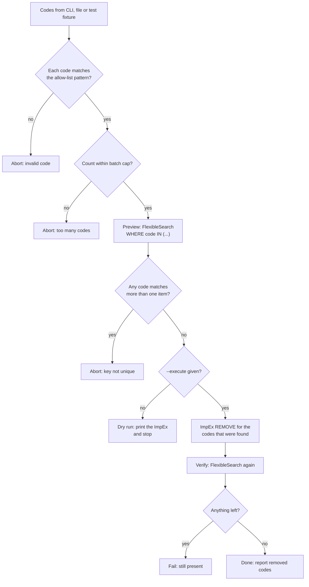

# Usage guide

Practical recipes for `hybris-hac-api`: checking a connection, looking data up, creating test data, and removing items safely by explicit code, plus dry-run patterns and running in CI. The [README](../README.md) has the full API reference; [ARCHITECTURE.md](ARCHITECTURE.md) explains what happens on the wire.

All examples use placeholders: `https://hac.example.com`, `ORDER-0001`, `ORDER-0002`, `PRODUCT-0001`. Credentials always come from environment variables.

## Contents

- [Basics](#basics)
- [Recipe 1: check the connection](#recipe-1-check-the-connection)
- [Recipe 2: look items up with FlexibleSearch](#recipe-2-look-items-up-with-flexiblesearch)
- [Recipe 3: create or update test data with ImpEx](#recipe-3-create-or-update-test-data-with-impex)
- [Recipe 4: remove items by explicit codes](#recipe-4-remove-items-by-explicit-codes)
- [Dry-run patterns](#dry-run-patterns)
- [Recipe 5: Groovy without committing](#recipe-5-groovy-without-committing)
- [Recipe 6: setup and teardown in a test suite](#recipe-6-setup-and-teardown-in-a-test-suite)
- [Running in CI](#running-in-ci)
- [Safety guardrails](#safety-guardrails)

## Basics

Three HAC tools, three methods:

| Task | HAC tool | Client method | Changes data? |
|---|---|---|---|
| Read data | FlexibleSearch | `client.search(query, options)` | no (read-only) |
| Create, update or remove data | ImpEx import | `client.importImpex(script, options)` | yes |
| Anything else (services, cron jobs, checks) | Scripting console (Groovy) | `client.runScript(script, options)` | yes, unless `commit: false` |

Two ImpEx facts used throughout this guide:

- The header line names a type and the attributes. An attribute marked `[unique=true]` is the lookup key: ImpEx finds the existing item by that value.
- The mode decides what happens to the item found: `INSERT`, `UPDATE`, `INSERT_UPDATE` or `REMOVE`.

```text
REMOVE Order; code[unique=true]
; ORDER-0001
; ORDER-0002
```

That script removes the orders whose `code` is `ORDER-0001` or `ORDER-0002`, and nothing else.

Create one client per script or test run and close it at the end. The client logs in once and reuses the session.

```javascript
const { createHacClient } = require('hybris-hac-api');
const hac = createHacClient(); // HAC_HOST, HAC_USER, HAC_PASSWORD from env or .env
// ... calls ...
hac.close();
```

## Recipe 1: check the connection

A cheap first step in a pipeline, so a wrong host or password fails fast with a clear error.

```javascript
'use strict';
const { createHacClient, HacError } = require('hybris-hac-api');

async function main() {
  const hac = createHacClient({ timeoutMs: 30000 });
  try {
    await hac.login();
    const { rows } = await hac.search('SELECT COUNT({pk}) FROM {Language}');
    console.log('HAC reachable, query returned', rows.length, 'row(s)');
  } finally {
    hac.close();
  }
}

main().catch((err) => {
  console.error(err instanceof HacError ? `${err.code}: ${err.message}` : err);
  process.exitCode = 1;
});
```

Typical failures: `HAC_CONFIG` (missing or malformed `HAC_HOST`), `HAC_AUTH` (credentials), `HAC_TIMEOUT` or `HAC_TRANSPORT` (network, VPN, proxy, certificate). See [Troubleshooting](../README.md#troubleshooting).

## Recipe 2: look items up with FlexibleSearch

`search()` returns every row up to `maxCount` (default 200). Column names drop HAC's `p_` prefix, so `{code}` becomes `row.code`. Print `result.columns` once if you are unsure what your HAC version returns.

```javascript
const { headers, columns, rows, rowCount } = await hac.search(
  "SELECT {code} FROM {Order} WHERE {code} IN ('ORDER-0001', 'ORDER-0002')",
  { maxCount: 10 },
);
console.log(headers);  // e.g. [ 'p_code' ] (as HAC returns them)
console.log(columns);  // e.g. [ 'code' ]
console.log(rowCount); // 0, 1 or 2
console.log(rows);     // e.g. [ { code: 'ORDER-0001' }, { code: 'ORDER-0002' } ]
```

- No rows is `rows: []`, not an error.
- A query HAC cannot parse rejects with `HacFlexibleSearchError`; `err.hacMessage` has HAC's reason.
- `{Order}` includes subtypes. Use `{Order!}` to match the exact type only.
- HAC's console does not support bind parameters, so values end up inside the query string. Only interpolate values you have validated (see [Recipe 4](#recipe-4-remove-items-by-explicit-codes)).

## Recipe 3: create or update test data with ImpEx

`INSERT_UPDATE` keyed on a unique attribute is re-runnable: the second run updates instead of failing.

```javascript
const impex = [
  'INSERT_UPDATE Product; code[unique=true]; name[lang=en]; catalogVersion(catalog(id), version)[unique=true]',
  '; PRODUCT-0001 ; Sample product one ; exampleProductCatalog:Staged',
  '; PRODUCT-0002 ; Sample product two ; exampleProductCatalog:Staged',
].join('\n');

const result = await hac.importImpex(impex);
console.log(result.level, result.message); // e.g. 'notice' 'Import finished successfully'
```

The call resolves only after HAC reports success. If HAC reports a problem, it rejects with `HacImpexError` (`err.level`, `err.result`). Use `{ validationMode: 'IMPORT_RELAXED' }` only when you know why strict validation fails.

## Recipe 4: remove items by explicit codes

The shape of a safe cleanup: validate the input, look the items up, show what would happen, remove only what was found, then check that it is gone.



Caption: the cleanup flow; every branch that is not the happy path stops before or right after a single, explicit REMOVE.

`cleanup-orders.js`:

```javascript
'use strict';
/**
 * Removes items by explicit code. Dry run unless --execute is given.
 *
 *   node cleanup-orders.js ORDER-0001 ORDER-0002            # preview only
 *   node cleanup-orders.js ORDER-0001 ORDER-0002 --execute  # remove
 */
const { createHacClient, HacError } = require('hybris-hac-api');

const TYPE = 'Order';                        // the item type to clean up
const KEY = 'code';                          // a unique attribute of TYPE
const CODE_PATTERN = /^[A-Za-z0-9_-]{1,64}$/; // allow-list: no quotes, semicolons or wildcards
const MAX_BATCH = 20;                        // refuse bigger runs

function parseArgs(argv) {
  const execute = argv.includes('--execute');
  const codes = [...new Set(argv.filter((arg) => !arg.startsWith('--')))];
  if (codes.length === 0) throw new Error('pass at least one code');
  if (codes.length > MAX_BATCH) throw new Error(`refusing ${codes.length} codes, the cap is ${MAX_BATCH}`);
  const invalid = codes.filter((code) => !CODE_PATTERN.test(code));
  if (invalid.length > 0) throw new Error(`invalid code(s): ${invalid.join(', ')}`);
  return { execute, codes };
}

/** Returns the KEY value of every item whose KEY is in `codes` (duplicates included). */
async function findByCodes(hac, codes) {
  const list = codes.map((code) => `'${code}'`).join(', ');
  const { rows } = await hac.search(`SELECT {${KEY}} FROM {${TYPE}} WHERE {${KEY}} IN (${list})`, {
    maxCount: MAX_BATCH * 2, // large enough to notice duplicates
  });
  return rows.map((row) => row[KEY]);
}

function removeImpex(codes) {
  return [`REMOVE ${TYPE}; ${KEY}[unique=true]`, ...codes.map((code) => `; ${code}`)].join('\n');
}

async function main() {
  const { execute, codes } = parseArgs(process.argv.slice(2));
  const hac = createHacClient();
  try {
    // 1. Preview
    const found = await findByCodes(hac, codes);
    const duplicates = [...new Set(found.filter((code, i) => found.indexOf(code) !== i))];
    if (duplicates.length > 0) {
      throw new Error(`${KEY} is not unique for: ${duplicates.join(', ')}; refusing to remove`);
    }
    const missing = codes.filter((code) => !found.includes(code));
    console.log(`found ${found.length} of ${codes.length}: ${found.join(', ') || '-'}`);
    if (missing.length > 0) console.log(`not found, skipped: ${missing.join(', ')}`);
    if (found.length === 0) return;

    const impex = removeImpex(found);
    if (!execute) {
      console.log(`dry run, would import:\n${impex}\nre-run with --execute to remove`);
      return;
    }

    // 2. Remove exactly what was found
    await hac.importImpex(impex);

    // 3. Verify
    const left = await findByCodes(hac, found);
    if (left.length > 0) throw new Error(`still present after removal: ${left.join(', ')}`);
    console.log(`removed: ${found.join(', ')}`);
  } finally {
    hac.close();
  }
}

main().catch((err) => {
  console.error(err instanceof HacError ? `${err.code}: ${err.message}` : err.message);
  process.exitCode = 1;
});
```

Example run:

```text
$ node cleanup-orders.js ORDER-0001 ORDER-0002 ORDER-0003
found 2 of 3: ORDER-0001, ORDER-0002
not found, skipped: ORDER-0003
dry run, would import:
REMOVE Order; code[unique=true]
; ORDER-0001
; ORDER-0002
re-run with --execute to remove

$ node cleanup-orders.js ORDER-0001 ORDER-0002 ORDER-0003 --execute
found 2 of 3: ORDER-0001, ORDER-0002
not found, skipped: ORDER-0003
removed: ORDER-0001, ORDER-0002
```

Why it is built this way:

- **Allow-list validation** keeps quotes, semicolons, line breaks and wildcards out of both the FlexibleSearch query and the ImpEx. A code like `ORDER-0001; 1=1` or `%` never reaches HAC.
- **Explicit keys only.** The script never derives codes from a pattern (`LIKE 'ORDER-%'`) or from other data. If you need related items removed too, list their codes explicitly, or check how your type system cascades removals (see below).
- **Preview first, remove only what was found.** Codes that do not exist are reported and skipped, so the ImpEx only contains lines that match an item.
- **Uniqueness check.** If the key matches more than one item, the script stops instead of guessing.
- **Verify after.** A successful import is not proof that the items are gone; the second query is.
- **Re-runnable.** If the run is interrupted, for example by a timeout after HAC accepted the import, running it again previews the current state and only removes what is still there.
- **No retry of the REMOVE.** `importImpex` is treated as unsafe: by default the client retries it only when the request was never sent. Do not set `retryOnTransientError: true` on destructive imports.

Related items: removing an item does not automatically remove everything that points to it. Whether children are removed with the parent depends on the relation definitions in your type system (for example `partOf` attributes). Check before you rely on it, and verify the related items with a FlexibleSearch in the same way.

## Dry-run patterns

HAC's ImpEx import has no "simulate" mode that this client exposes, so a dry run is something your script does before it imports.

| Pattern | How | Good for |
|---|---|---|
| Preview with FlexibleSearch | Run the `SELECT` that matches what the ImpEx would touch, print it, stop. | REMOVE and UPDATE of existing items (Recipe 4) |
| Print the ImpEx | Build the script, print it, import only with an explicit `--execute` flag or `DRY_RUN=false`. | Reviews and CI logs |
| Groovy without commit | `runScript(script, { commit: false })` asks HAC to roll the script's transaction back. | Checking that a script runs; see the caveat in Recipe 5 |
| Rehearse on a non-production HAC | Point `HAC_HOST` at a disposable environment first. | Anything large or new |

Make "dry run" the default and "execute" the explicit choice, as in Recipe 4. In CI that means the destructive job needs a deliberate input to run.

## Recipe 5: Groovy without committing

```javascript
const { output, result } = await hac.runScript(
  [
    'def query = "SELECT {pk} FROM {Order} WHERE {code} IN (?codes)"',
    'def found = flexibleSearchService.search(query, [codes: ["ORDER-0001", "ORDER-0002"]]).result',
    'println "would touch ${found.size()} item(s)"',
    'return found.size()',
  ].join('\n'),
  { commit: false },
);
console.log(output.trim(), result);
```

Groovy can use real bind parameters (`?codes` above), which is safer than string-built FlexibleSearch when input comes from outside.

Caveat: `commit: false` rolls back the database transaction of the script. Side effects outside that transaction (sending email, calling other systems, file writes, work started in other threads) are not rolled back. Treat it as a check, not a sandbox.

If the script throws, the call rejects with `HacScriptError` (`err.stacktrace`, `err.output`).

## Recipe 6: setup and teardown in a test suite

Create data before the tests and remove it afterwards with the same explicit codes. The example uses `node:test`; the same shape works with Jest, Mocha or Playwright hooks.

```javascript
'use strict';
const { before, after, test } = require('node:test');
const assert = require('node:assert/strict');
const { createHacClient } = require('hybris-hac-api');

const CODES = ['PRODUCT-0001', 'PRODUCT-0002'];
const CATALOG = 'exampleProductCatalog:Staged';
let hac;

before(async () => {
  hac = createHacClient();
  await hac.importImpex(
    [
      'INSERT_UPDATE Product; code[unique=true]; name[lang=en]; catalogVersion(catalog(id), version)[unique=true]',
      ...CODES.map((code) => `; ${code} ; Test ${code} ; ${CATALOG}`),
    ].join('\n'),
  );
});

after(async () => {
  try {
    await hac.importImpex(
      [
        'REMOVE Product; code[unique=true]; catalogVersion(catalog(id), version)[unique=true]',
        ...CODES.map((code) => `; ${code} ; ${CATALOG}`),
      ].join('\n'),
    );
    const list = CODES.map((code) => `'${code}'`).join(', ');
    const { rows } = await hac.search(`SELECT {code} FROM {Product} WHERE {code} IN (${list})`);
    assert.equal(rows.length, 0, 'test products were not removed');
  } finally {
    hac.close();
  }
});

test('test data exists', async () => {
  const { rows } = await hac.search("SELECT {code} FROM {Product} WHERE {code} = 'PRODUCT-0001'");
  assert.equal(rows.length, 1);
});
```

The codes are constants owned by the test, so teardown can only remove what setup created. Products are unique per catalog version, so both key attributes appear in the REMOVE header.

## Running in CI

Configuration comes from environment variables, so a pipeline only needs to set them. Keep the password in the CI system's secret store so it is masked in logs.

| Variable | Where it comes from in CI |
|---|---|
| `HAC_HOST` | pipeline variable, e.g. `https://hac.example.com` |
| `HAC_USER` | pipeline variable or secret |
| `HAC_PASSWORD` | masked secret, never in the repository |
| `HAC_CA_CERT` or `HAC_TLS_REJECT_UNAUTHORIZED=true` | turn TLS verification on |
| `HAC_TIMEOUT_MS` | raise for long imports |
| `HAC_DEBUG` | `true` while diagnosing; output contains no secrets |
| `HTTPS_PROXY`, `NO_PROXY` | when the runner reaches HAC through a proxy |

GitHub Actions example with a manual, opt-in destructive job:

```yaml
name: hac-cleanup
on:
  workflow_dispatch:
    inputs:
      codes:
        description: Space-separated codes to remove
        required: true
      execute:
        description: Actually remove (otherwise dry run)
        type: boolean
        default: false

jobs:
  cleanup:
    runs-on: ubuntu-latest
    environment: test            # protect with required reviewers if needed
    env:
      HAC_HOST: ${{ vars.HAC_HOST }}
      HAC_USER: ${{ vars.HAC_USER }}
      HAC_PASSWORD: ${{ secrets.HAC_PASSWORD }}
      HAC_TLS_REJECT_UNAUTHORIZED: 'true'
      CODES: ${{ inputs.codes }}
    steps:
      - uses: actions/checkout@v4
      - uses: actions/setup-node@v4
        with:
          node-version: 20
      - run: npm ci
      - name: Cleanup
        run: |
          if [ "${{ inputs.execute }}" = "true" ]; then
            node cleanup-orders.js $CODES --execute
          else
            node cleanup-orders.js $CODES
          fi
```

Free-text input is passed through an environment variable rather than pasted into the script, and `cleanup-orders.js` validates each code itself. Other CI systems work the same way: define `HAC_PASSWORD` as a masked or protected variable and pass everything else as plain variables.

Tips:

- Do not commit a `.env` file with real values. Add it to `.gitignore`; the library reads it only for local runs.
- Log `err.toJSON()` or `err.code` and `err.message`. They contain no password, cookie or CSRF token.
- Fail the job on any rejection (`process.exitCode = 1`), so silent partial cleanups cannot pass.
- Give the CI HAC user only the rights the job needs.

## Safety guardrails

A checklist for any script that changes data through HAC:

| Guardrail | Why |
|---|---|
| Explicit keys only. Every item to change is named by a unique attribute value. | Nothing is changed by accident through a pattern or a join. |
| No wildcard or pattern deletes (`LIKE`, `%`, "all items of type X"). | One typo can empty a table. |
| Allow-list validation of every external value. | Keeps quotes, `;` and line breaks out of ImpEx and FlexibleSearch. |
| Batch cap per run. | Limits the damage of a wrong input list. |
| Dry run by default, `--execute` to act. | Destructive runs are always deliberate. |
| Preview before, verify after, with FlexibleSearch. | A successful import is not proof of the end state. |
| Stop on ambiguity (key matches more than one item). | Do not guess which one to delete. |
| No transient retry for destructive imports (keep the default). | Avoids replaying a request HAC may already have processed. |
| Re-runnable scripts. | A timeout or crash is fixed by running again. |
| TLS verification on, secrets in a secret store. | Protects HAC credentials in transit and at rest. |
| Separate, least-privilege HAC user for automation. | Limits what a leaked credential or a bug can do. |
| Never point cleanup automation at production without review. | HAC has full rights over the data. |
